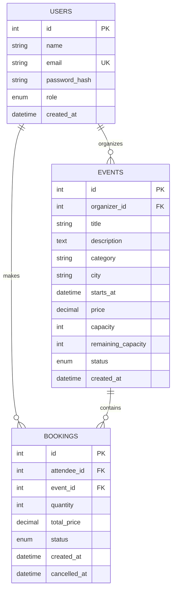

# Data Model

## Relationships

- One organizer can own many events.
- One attendee can make many bookings.
- One event can have many bookings.
- `organizer_id`, `attendee_id`, `event_id`, status, role, and event discovery fields are indexed where useful.
- User/event and user/booking foreign keys use cascading deletion.
- Event bookings use ORM delete-orphan cascading, but the API deliberately prevents deleting an event that already has bookings so historical booking records are not silently destroyed. Organizers should cancel such events instead, which marks confirmed bookings as refunded.

## Capacity invariant

For an upcoming event:

`0 <= remaining_capacity <= capacity`

and:

`capacity - remaining_capacity = tickets represented by active/confirmed bookings`

The booking transaction locks the event row before checking or changing `remaining_capacity`.

## Search and indexing

`GET /events?q=...` runs a case-insensitive `ILIKE '%text%'` over `events.title`, `events.description` and `events.category`. This pattern cannot use B-tree indexes, so no search-specific index is defined. Candidate rows are already narrowed by the existing `status`, `starts_at`, `city` and `category` indexes. For a large events table, a `pg_trgm` GIN index is the recommended addition; see the README for the SQL. It is not created automatically because it requires the `pg_trgm` extension and the project has no migration tooling to apply it to existing databases.
